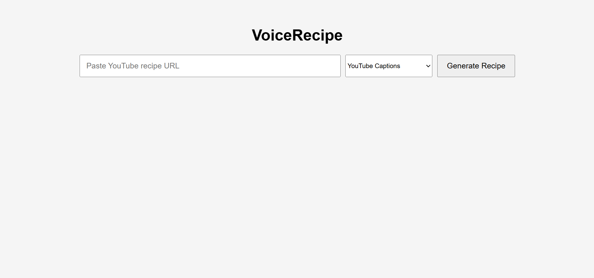
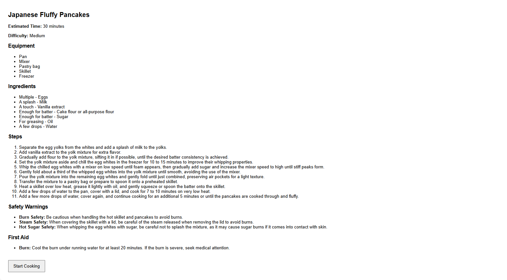
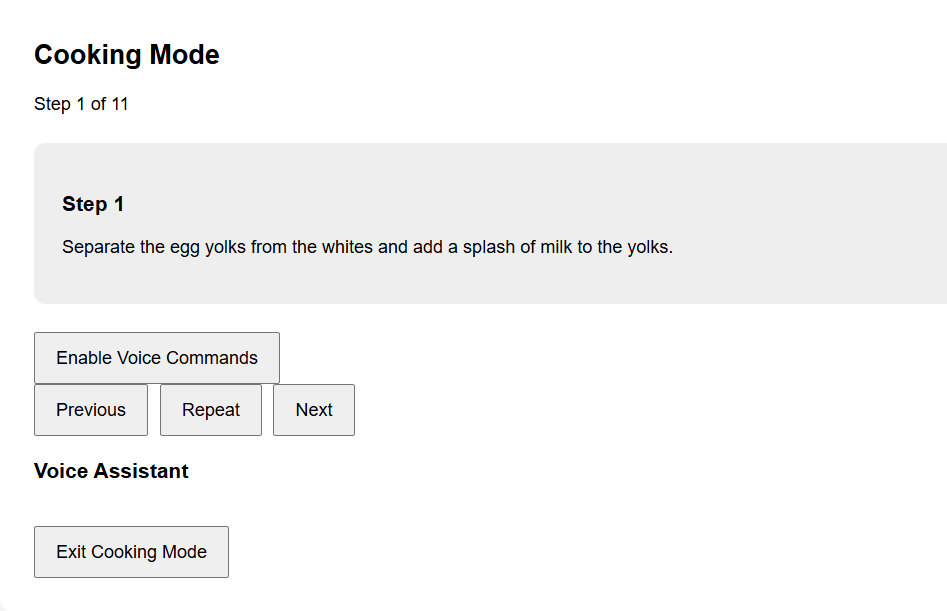

# VoiceRecipe

VoiceRecipe turns the captions of a YouTube cooking video into a recipe with ingredients, steps, and relevant safety guidance. Cooking mode reads each step aloud, accepts voice commands when the browser supports speech recognition, and answers questions about the current step. Step buttons work without a microphone.

## How it works

1. The React and Vite frontend sends a YouTube link to the FastAPI backend.
2. The backend fetches captions with `youtube-transcript-api`, removes music and applause markers, and asks Groq for a structured recipe. If captions are blocked or unavailable and `GEMINI_API_KEY` is set, Gemini reads the public video directly and supplies cooking notes to the same recipe parser.
3. Pydantic checks the recipe before a second Groq call adds safety information.
4. The frontend displays the recipe. Cooking mode uses the browser's Web Speech APIs for speech playback and optional voice commands. Questions go to the backend's `/ask/` endpoint.

Without the optional Gemini fallback, the app needs a video with accessible captions or a transcript pasted by the user. The fallback can use audio and visible details from public videos. AI-generated recipes and safety guidance should be checked against the source video before cooking.

## Requirements

- Python and Node.js versions compatible with the pinned packages
- A Groq API key (the project uses Groq's free developer tier)
- A browser with speech synthesis; browser speech recognition is optional and requires microphone permission

The default Groq model is `openai/gpt-oss-120b`. Set `GROQ_MODEL` if your Groq account has access to a different compatible model that supports JSON output. Provider rate limits and model availability can change.

## Run locally

From the `backend` folder, create a virtual environment and install the core packages:

```powershell
cd backend
python -m venv venv
.\venv\Scripts\python.exe -m pip install -r requirements.txt
```

Create `backend/.env`:

```dotenv
GROQ_API_KEY=your_key_here
# Optional: GROQ_MODEL=openai/gpt-oss-120b
# Optional: ALLOWED_ORIGINS=http://localhost:5173,http://127.0.0.1:5173
# Optional: GEMINI_API_KEY=your_free_key_here
```

Start the backend:

```powershell
.\venv\Scripts\python.exe -m uvicorn main:app --reload
```

In a second terminal, from the `frontend` folder:

```powershell
cd frontend
npm install
npm run dev
```

Open the address printed by Vite (normally `http://localhost:5173`). The frontend expects the API at `http://127.0.0.1:8000`. For a different API address, set `VITE_API_URL` in `frontend/.env.local` and restart Vite. Add the frontend's exact origin to the comma-separated `ALLOWED_ORIGINS` setting if needed.

## Use

Paste a YouTube watch, short, live, or `youtu.be` link and select **Generate Recipe**. If the server cannot fetch captions, expand **Have a transcript? Paste it instead**, copy the video's transcript from YouTube, and select **Generate from Transcript**. This fallback uses the same recipe and safety checks without requiring the backend to contact YouTube. Review the ingredients and steps, then select **Start Cooking**. Use the step buttons or enable voice commands and say “next”, “previous”, “repeat”, or a question about the recipe. Speech recognition may be unavailable in some browsers; the step buttons remain usable. **Try Another Video** returns to the link form.

YouTube may block transcript requests from cloud-server IP addresses even when the same video works locally. The app distinguishes blocked requests from missing captions and unavailable videos. A different cloud host is not a guaranteed fix. See the [transcript library's IP-blocking notes](https://github.com/jdepoix/youtube-transcript-api#working-around-ip-bans-requestblocked-or-ipblocked-exception).

### Restore automatic YouTube links on Render

The deployed frontend uses the Render backend. To keep the YouTube-link flow working when Render's caption request is blocked:

1. Create a **free** Gemini API key in [Google AI Studio](https://aistudio.google.com/app/apikey). Keep the project on the free tier; do not enable billing for this app.
2. In the Render backend service, add a secret environment variable named `GEMINI_API_KEY` with that key. Do not put the key in Vercel's `VITE_` variables, Git, or frontend files.
3. Deploy this backend version to Render. Render restarts the service after the environment change. No frontend API URL change is needed.
4. Try `https://www.youtube.com/watch?v=7goNbTdFwNM` on the deployed site. If it fails, check Render logs for a `Gemini video fallback failed` warning and check whether the Gemini key/model is available to the free project.

This uses Gemini's documented YouTube URL input with the free-tier `gemini-3.8-flash` model. It works only for public videos, has free-tier limits, and the URL feature is currently in preview, so availability can change. Caption retrieval remains the first choice. The pasted-transcript option still works if neither automatic source can read a video. See [Google's video input guide](https://ai.google.dev/gemini-api/docs/video-understanding) and [free-tier pricing](https://ai.google.dev/gemini-api/docs/pricing).

The **Whisper AI** option is disabled. The experimental transcriber source remains in `backend/services/whisper_transcriber.py`; it is not wired into the API. Its optional packages are listed in `backend/requirements-whisper.txt` and are not needed for the working captions mode. Long captions are rejected before they reach Groq so the free-tier request stays manageable.

## Checks

Install `backend/requirements-dev.txt` to run the backend regression tests:

```powershell
cd backend
.\venv\Scripts\python.exe -m pip install -r requirements-dev.txt
.\venv\Scripts\python.exe -B -m unittest discover -s tests -v
```

From `frontend`, run `npm run lint` and `npm run build`. A live end-to-end demo also needs an accessible YouTube caption track, a working Groq key, and (for voice input) a supported browser with microphone permission.

## Screenshots







## Possible later additions

- Enable the experimental Whisper path for videos without captions after testing downloads, transcription time, and file cleanup.
- Add cooking timers and saved recipes if they are useful for the demonstration.

Created by Swara Patil.
